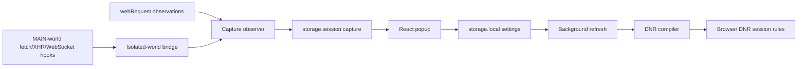

# Repository Guidelines

## Project Overview

ModHeaderX is a self-contained Chrome/Firefox Manifest V3 extension for modifying HTTP request/response headers. It provides profiles, URL/resource filters, pause/tab lock, profile import/export, chunked cloud backup, and opt-in HTTP/WebSocket capture. WXT builds the React/TypeScript/MUI popup and browser-specific extension bundles.

## Architecture & Data Flow



- Settings coordination primarily uses storage subscriptions, not popup/background RPC. The popup also compiles profiles for degradation notices; only the background installs rules. Header modification does not depend on blocking `webRequest` or an awake worker.
- Capture listeners/scripts are enabled while recording. HTTP bodies correlate by method/URL/time; WebSocket events bind to handshake rows using tab/frame/socket identity. Do not assume page hooks share browser network request IDs.
- Capture falls back to local storage only when session storage is unavailable; that fallback is cleared at browser startup. HTTP and WebSocket recording are independent. Neither logs nor frames belong in profile dumps or cloud backups.
- Legacy migration reads localStorage through a Chrome offscreen document/hidden-tab fallback or Firefox background DOM; background owns the migrated writes. Cloud snapshots use quota-safe chunks in `storage.sync`.

## Key Directories

- `entrypoints/`: WXT background, popup, and migration contexts; no conventional `src/` tree.
- `components/`: controlled React/MUI editors, dialogs, and capture views.
- `lib/`: typed models, pure compilation/matching, persistence, capture orchestration, migration, and backup.
- `public/`: injected plain-JavaScript hooks and copied assets; hooks intentionally have no application imports.
- `tests/unit/`, `tests/e2e/`: core/fake-browser tests and real-extension browser tests.
- `specs/`, `.specify/`: feature contracts/manual scenarios, current constitution, and optional specification tooling. Historical plans/task checkmarks are not runtime or verification evidence.

## Development Commands

Enable Corepack (`corepack enable`; install Corepack separately if unavailable), then:

```sh
pnpm install                         # postinstall generates .wxt/ with wxt prepare
pnpm run dev                         # Chrome live reload
pnpm run dev:firefox                  # Firefox MV3 live reload
pnpm run build                       # .output/chrome-mv3
pnpm run build:firefox                # .output/firefox-mv3
pnpm run zip                         # Chrome, Firefox, and source ZIPs in dist/
pnpm run compile                     # strict TypeScript checking
pnpm run lint                        # ESLint
pnpm run test                        # all unit tests
pnpm run test tests/unit/dnr.test.ts  # targeted unit file
pnpm exec playwright install chromium
pnpm run test:e2e --project=chromium  # build Chrome first; rebuild after changes
```

For manual loading, use the production output directories; Firefox's `about:debugging` selects `.output/firefox-mv3/manifest.json`.

## Code Conventions & Common Patterns

- Follow existing two-space indentation, single quotes, semicolons, and trailing commas. Components use PascalCase `.tsx`; helpers use kebab-case `.ts`; functions/variables use camelCase. No formatter script is defined.
- TypeScript is strict. Use `~/lib/...` aliases and `browser`/`Browser` from `wxt/browser` in extension TypeScript. Feature-detect optional APIs; injected public scripts instead use raw `chrome.runtime`.
- UI uses hooks, controlled props, immutable updates, MUI `sx`, and the system-aware theme in `Root.tsx`; no global state container or DI framework. Small interfaces such as `LegacyStorageLike` provide test seams.
- Preserve optimistic popup edits before async persistence: storage echoes must not reset controlled-input cursor/selection/undo. Preserve compatible model fields and absent-key defaults in `lib/types.ts`/`lib/storage.ts`.
- Profile slots are positional. Reorder/delete/undo must remap recording flags, HTTP entries, view filters, and sockets together using session-store helpers.
- Keep `dnr.ts` compilation and `request-match.ts` filtering aligned. Preserve visible unsupported-operation notices, RE2 constraints, append degradation, and rule limits rather than silently dropping errors.
- Session mutations use recovering promise queues; these are not cross-context locks. Persist bindings needed after worker restart immediately; high-rate capture writes may coalesce for at most one second. Preserve monotonic terminal states, richer existing bodies/headers, bounded buffers, and truncation/drop metadata.
- Handle failures at their boundary: invalid imports return parse failure, optional injection can yield unavailable capture, background failures warn, and manual operation failures notify the user. Do not blanket-catch native network failures or fabricate missing payloads.
- Captured headers/cURL intentionally retain real credentials. Keep capture session-only and preserve explicit unavailable-versus-empty distinctions.

## Important Files

- `entrypoints/background.ts`: startup/migration, rule replacement, recording reconciliation, menus/badge, automatic backup.
- `entrypoints/popup/App.tsx`, `entrypoints/popup/Root.tsx`: state ownership/actions and theme setup.
- `lib/types.ts`, `lib/storage.ts`: compatible data model and persistent-state subscriptions.
- `lib/dnr.ts`, `lib/request-match.ts`: rule compiler and observer eligibility/matching.
- `lib/request-log-observer.ts`, `lib/session-log.ts`: hook orchestration, correlations, bounded HTTP/socket stores.
- `public/request-log-main.js`, `public/request-log-hook.js`: page-world instrumentation and isolated bridge.
- `lib/migration.ts`, `lib/backup.ts`, `lib/dump.ts`: legacy migration, sync snapshots, JSON `Profile[]` import/export.
- `wxt.config.ts`, `package.json`, `.github/workflows/release.yml`: manifest/build, command/manager contract, release pipeline.

## Runtime/Tooling Preferences

- Use Node.js and **pnpm 12.11.2**, pinned in `package.json`; do not introduce npm/yarn lockfiles or a Bun workflow. Align Node with CI's current **22.x**; no `engines` minimum is declared, and older “Node ≥20” docs are not a precise dependency requirement.
- Use `pnpm install --frozen-lockfile` in CI. Let pnpm manage `pnpm-lock.yaml`, including its package-manager metadata. `tsconfig.json` extends generated `.wxt/tsconfig.json`.
- Do not edit generated `.wxt/`, `.output/`, `dist/`, or test-report artifacts. Maintain manifests in `wxt.config.ts`, not a second JSON manifest. Firefox requires version 140+; `offscreen` is Chrome-only.
- Bundle runtime code/styles locally; no runtime CDN code. Minimize permissions and justify dependency changes. Follow `.specify/memory/constitution.md`; bump application versions only for releases.
- Optional Spec-Kit scripts live in `.specify/scripts/python/` and `powershell/`, not `bash/`. Read-only feature discovery: `python3 .specify/scripts/python/check_prerequisites.py --paths-only --json`. Other prerequisite modes can update `.specify/feature.json`.

## Testing & QA

- Vitest uses `WxtVitest()` in `vitest.config.ts` and `tests/unit/**/*.test.ts`. `tests/unit/setup.ts` resets `fakeBrowser` after each test; restore explicit spies and unsubscribe listeners yourself. Test pure logic directly and storage behavior through the fake browser.
- Playwright uses `tests/e2e/**/*.spec.ts`, one worker, persistent per-test Chromium contexts, and a worker-scoped local HTTP/WebSocket server in `tests/e2e/fixtures.ts`. Seed real extension storage through service-worker evaluation; prefer accessible role/label selectors and observable network/UI outcomes.
- **Firefox extension E2E is not implemented:** the configured Firefox project hits unsupported fixtures or Chromium-only cases. Unfiltered `pnpm run test:e2e` is not a working cross-browser check. Use the Chromium selection above and manual Firefox verification.
- Add/update behavior tests alongside core changes and major user flows. No numeric coverage threshold/provider is configured. Rebuild before E2E; fake-browser tests do not prove actual DNR behavior.
- Release CI runs lint, type-check, unit tests, and both-browser ZIP packaging, **not E2E**. Extension-API changes and release sign-off require manual Chrome/Firefox scenarios from the relevant feature `quickstart.md`; `.specify/feature.json` identifies the active feature. Check already-open-page body capture, worker/browser restart behavior, HTTP/WS isolation, and bounded retention when touching capture.
